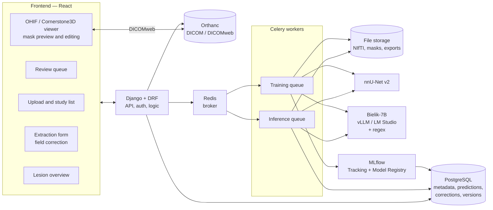
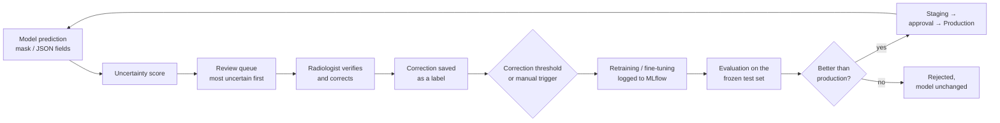

# MRI Breast Analysis — Web Application with Expert-in-the-Loop Learning

## 1. Project goal

A web application for a hospital to analyse lesions in breast MRI, combining two sources of information:

1. **Image** — automatic lesion segmentation based on a DICOM series (nnU-Net v2).
2. **Radiology report** — automatic extraction of structured BI-RADS data from the report text (Bielik LLM + rules).

Both modules work in a **human-in-the-loop** scheme: the model proposes a result (a mask or filled-in fields), the radiologist verifies and corrects it, and the corrections return to the system as verified labels. Based on them, the models are periodically fine-tuned, evaluated and — after passing a quality gate — deployed as new versions. The entire model lifecycle is tracked in **MLflow**.

The project is part of a broader research plan (ZPI + TransMed/ABM): structuring radiology reports → image segmentation → ultimately work on minimising surgical margins.

### Functional scope

- Upload of DICOM series (breast MRI) and the radiology report
- Automatic lesion segmentation (nnU-Net v2) with uncertainty estimation
- Automatic extraction of lesion parameters from the report (size, shape, margins, enhancement type, BI-RADS category, etc.)
- MRI visualisation with an overlaid mask in the viewer and **mask editing** by the radiologist
- Form for verifying and correcting data extracted from the report
- **Review queue** sorted by model uncertainty (active learning)
- **Lesion overview** — an integrated view: image + mask, quantitative metrics (volume, dimensions) and data from the report
- Model fine-tuning pipeline on corrections, with a quality gate and a version registry (MLflow)
- Admin panel: cases, model versions, metrics

---

## 2. System architecture



---

## 3. Application modules

### 3.1 Segmentation

1. DICOM series upload → Orthanc → database record.
2. Celery task: DICOM → NIfTI conversion → `nnUNetv2_predict` with `--save_probabilities`.
3. The mask, metrics (volume, dimensions) and an **uncertainty score** are saved.
4. The mask is displayed in the viewer; the radiologist accepts it or corrects it with brush/eraser tools.
5. The corrected mask is stored in the database as a verified label.

### 3.2 Report data extraction

1. Radiology report → Bielik-7B (prompt with few-shot examples) → JSON with BI-RADS fields.
2. Rule-based post-processing (regex), among others for known model errors: confusing the distance from the nipple with the lesion dimensions, microcalcifications in a negation context.
3. The result and a per-field **uncertainty score** are saved.
4. A form next to the report text — the radiologist accepts or corrects the fields; a per-field diff is stored.

### 3.3 Lesion overview

An integrated view of a single lesion combining:
- the MRI image with the segmentation mask,
- quantitative metrics from the segmentation (volume, dimensions, intensity features),
- structured data extracted from the report,
- verification status and the model versions that produced the result.

It allows comparing data from the image and from the report (e.g. lesion size from the mask vs. the size given in the report).

---

## 4. ML pipeline — expert-in-the-loop learning

### 4.1 Cycle



### 4.2 Active learning — selecting cases for review

The radiologist does not review cases in random order — the system shows first those the model is least certain about. This way every correction brings the most information.

| Module | Uncertainty measure |
|---|---|
| Segmentation | disagreement between the predictions of the 5 nnU-Net folds (ensemble); mean entropy of the probability maps within the lesion |
| Extraction | token logprobs of field values (when served by vLLM); LLM vs. regex disagreement; self-consistency (several calls, divergent answers) |

### 4.3 Retraining and quality gate

**Segmentation**
- Export of verified cases to the nnU-Net format (`imagesTr` / `labelsTr`).
- Fine-tuning from the weights of the current production model (`-pretrained_weights`, reduced number of epochs).
- Metrics: Dice, HD95 on the frozen test set.

**Extraction** — two stages:
- *From the start:* corrections feed a pool of few-shot examples; the most similar reports (embeddings) are selected for the prompt. The prompt + example set is versioned.
- *With a few hundred corrections:* LoRA/QLoRA fine-tuning of Bielik; adapters as subsequent model versions.
- Metrics: per-field precision / recall / F1 on the frozen test set.

**Quality gate rules**
- The test set is frozen and never used for training.
- A new version goes to `Staging` only if it improves the main metric without significantly degrading the others.
- Promotion to `Production` requires human approval (no automatic model replacement in a medical environment).

### 4.4 What we log in MLflow

- training parameters / prompt configuration, data version (list of case IDs + hash),
- test set metrics, training time,
- artifacts: weights / LoRA adapter, prompt, few-shot pool, sample predictions,
- Model Registry stage: `None` → `Staging` → `Production` → `Archived`.

---

## 5. Component description

### Frontend
- **React + OHIF Viewer / Cornerstone3D** — MRI visualisation with the mask, segmentation tools (brush, eraser) for correcting masks.
- DICOM and report upload, study list, review queue, extraction form, lesion overview, model versions panel.

### Backend — Django + Django REST Framework
- Business logic, authentication, roles: radiologist, admin, researcher.
- ORM: Patient → Study → DICOM Series / Report → Prediction → Correction; model versions.
- Django Admin as a data review panel.
- DRF exposes the REST API for the frontend.

### Asynchronous processing — Celery
- Separate `inference` and `training` queues. With a single GPU, training tasks do not run in parallel with inference; with several GPUs, each queue has a dedicated card (`CUDA_VISIBLE_DEVICES`).
- The frontend receives a `task_id` and polls for the status (polling) or receives a notification (WebSocket).

### Models
- **nnU-Net v2** — 3D segmentation; target `3d_fullres` (or `3d_cascade_fullres`), 5-fold ensemble.
- **Bielik-7B** — report extraction; dev: LM Studio (quantised), target: vLLM (higher precision, logprobs, LoRA adapters).
- MONAI as an alternative library if needed.

### MLflow
- Tracking Server with a PostgreSQL backend and artifacts in file storage.
- Model Registry as the source of truth about which model version is in production.

### Storage
- **Orthanc** — DICOM server (PACS) with DICOMweb; image source for the viewer.
- **PostgreSQL** — metadata, predictions, corrections, users, MLflow metadata.
- **File storage** (local FS or S3-compatible) — NIfTI, masks, dataset exports, MLflow artifacts.

---

## 6. Data model (core of the learning loop)

| Entity | Key fields |
|---|---|
| `ModelVersion` | module (seg / ext), name, `mlflow_run_id`, stage, test metrics |
| `Prediction` | case, `model_version`, result (mask path / JSON), `uncertainty`, status: `pending_review` / `accepted` / `corrected` |
| `Correction` | `prediction`, corrected mask / JSON, diff, author, date, editing time |
| `DatasetSplit` | case, split: `train` / `test` (test frozen) |
| `TrainingRun` | module, trigger, list of cases, status, `mlflow_run_id`, gate decision |

---

## 7. Technology stack

| Layer | Technology |
|---|---|
| Backend | Django, Django REST Framework |
| Async tasks | Celery, Redis |
| ML segmentation | nnU-Net v2 (possibly MONAI) |
| NLP extraction | Bielik-7B (LM Studio → vLLM), regex, embeddings for few-shot selection |
| MLOps | MLflow Tracking + Model Registry |
| DICOM conversion | pydicom, nibabel |
| DICOM server (PACS) | Orthanc (DICOMweb) |
| Database | PostgreSQL |
| Frontend | React, OHIF Viewer / Cornerstone3D |
| Containerisation | Docker / docker-compose |
| GPU | dev: RTX 4050 (6 GB); training and prod: GPU with more memory (to be decided) |

---

## 8. Repository structure

```
mri-breast-analysis/
├── backend/
│   ├── config/              # settings, urls, celery.py
│   ├── patients/            # patients, studies, series, reports
│   ├── segmentation/        # mask predictions and corrections, metrics
│   ├── extraction/          # report field predictions and corrections
│   ├── review/              # review queue, uncertainty score
│   ├── mlops/               # ModelVersion, TrainingRun, MLflow integration
│   ├── inference/           # nnU-Net and Bielik wrappers, DICOM→NIfTI conversion
│   ├── requirements.txt
│   └── manage.py
├── training/
│   ├── segmentation/        # export to nnU-Net format, fine-tuning, evaluation
│   └── extraction/          # few-shot pool, LoRA, per-field F1 evaluation
├── frontend/
│   ├── src/
│   │   ├── components/      # upload, study list, queue, extraction form
│   │   ├── viewer/          # OHIF/Cornerstone3D, mask editing
│   │   └── lesion-overview/ # lesion overview
│   └── package.json
├── orthanc/orthanc.json
├── docker-compose.yml       # Django, Celery, Redis, Orthanc, Postgres, MLflow
├── docs/                    # requirements, architecture, ZPI documentation
└── README.md
```

---

## Getting started

### Prerequisites

- Docker with Docker Compose v2
- (optional, for local development outside containers) Python 3.12 and Node.js 24 LTS

### Run the stack

```bash
cp .env.example .env      # adjust values if needed (ports, secrets)
docker compose up --build
```

This starts `postgres`, `redis`, `backend` (Django + DRF) and `frontend` (React + Vite). The backend applies database migrations on start. ML services (`mlflow`, Celery workers) are in the `ml` compose profile and are not started by default.

To create an admin account:

```bash
docker compose exec backend python manage.py createsuperuser
```

| Service | URL |
|---|---|
| Frontend (study list) | http://localhost:5173 |
| Backend API – health | http://localhost:8000/api/health |
| Backend API – studies | http://localhost:8000/api/studies |
| Django admin | http://localhost:8000/admin/ |

If ports `5432` or `8000` are already taken on your machine, change `POSTGRES_HOST_PORT` / `BACKEND_HOST_PORT` in `.env` (and keep `VITE_API_URL` in sync with the backend port).

The frontend calls the backend directly at `VITE_API_URL`; the backend allows it through CORS (`CORS_ALLOWED_ORIGINS`).

### Orthanc / OHIF

Orthanc runs with the DICOMweb and OHIF plugins enabled (config in `orthanc/orthanc.json`). It is also started by `docker compose up`; to run only the viewer:

```bash
cp .env.example .env      # if not done yet
docker compose up -d orthanc
```

| Service | URL |
|---|---|
| Orthanc UI (upload studies) | http://localhost:8042/ui/app/ |
| OHIF viewer | http://localhost:8042/ohif/ |
| DICOMweb | http://localhost:8042/dicom-web/studies |

Local credentials: `orthanc` / `orthanc` (development only). DICOM C-STORE is available on port `4242` (AET `ORTHANC`).

#### Run the viewer with sample data

1. Download a breast MRI study, e.g. one patient from [Duke-Breast-Cancer-MRI](https://www.cancerimagingarchive.net/collection/duke-breast-cancer-mri/) (TCIA, use the NBIA Data Retriever).
2. Open http://localhost:8042/ui/app/, click *Upload* and drop the DICOM folder.
3. Open http://localhost:8042/ohif/ and select the study.

Never commit DICOM or patient data — everything under `data/` is git-ignored.

The backend treats Orthanc as an external service reached via `ORTHANC_URL` (from inside the Docker network) and builds viewer links with `ORTHANC_PUBLIC_URL` (as seen from the browser). If both `ORTHANC_USER` and `ORTHANC_PASSWORD` are set, the backend sends them as HTTP basic auth.

`/api/health` always returns `200` while the API and database are up, and reports Orthanc as `"ok"`, `"unauthorized"` (credentials rejected) or `"unreachable"`. `/api/studies` returns `503` with an explanatory message when Orthanc is unreachable or rejects the credentials.

### Tests

```bash
docker compose run --rm backend python manage.py test
```
## Git workflow

`master` is protected: all changes go through a pull request with at least 1 approval. No direct pushes, no force pushes.

One branch per task, created from an up-to-date `master` and deleted after merge. Branch names follow `<area>/<short-description>`:

| prefix | area |
|---|---|
| `seg/` | segmentation (MRI, nnU-Net) |
| `ext/` | report data extraction |
| `backend/` | backend & infrastructure |
| `frontend/` | frontend |
| `docs/` | documentation |

Example: `seg/nnunet-baseline`. Other names are rejected on push (enforced by repository rulesets).

```bash
git switch master && git pull
git switch -c seg/my-task
# ...work, commit...
git push -u origin seg/my-task   # then open a PR on GitHub
```

## Data

Medical data (`.nii`, `.nii.gz`, `.dcm`, everything under `data/`) is **never** committed; see `.gitignore`.
The only exception is `data/splits/*.csv`: split definitions containing patient IDs only, no image data.

### Frozen test set

`data/splits/frozen_split_official.csv`: official MAMA-MIA split, 1,200 train / 306 test.
**Do not modify it.** Train and cross-validate on the train cases only; the test set is used once, for final evaluation.
Background and dataset analysis: `notebook/01_eda_mamamia_segmentation.ipynb`.