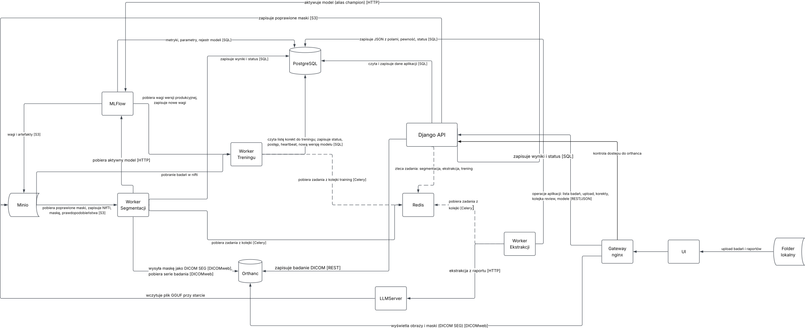

# MRI Breast Analysis — Web Application with Expert-in-the-Loop Learning

## 1. Project goal

A web application for a hospital to analyse lesions in breast MRI, combining two sources of information:

1. **Image** — automatic lesion segmentation based on a DICOM series (nnU-Net v2).
2. **Radiology report** — automatic extraction of structured BI-RADS data from the report text (Bielik LLM + rules).

Both modules work in a **human-in-the-loop** scheme: the model proposes a result (a mask or filled-in fields), the radiologist verifies and corrects it, and the corrections return to the system as verified labels. Based on them, the models are periodically fine-tuned, evaluated and — after passing a quality gate — deployed as new versions. The entire model lifecycle is tracked in **MLflow**.

The project is part of a broader research plan (ZPI + TransMed/ABM): structuring radiology reports → image segmentation → ultimately work on minimising surgical margins.

### Functional scope

- Upload of DICOM series (breast MRI) and the radiology report
- Automatic lesion segmentation (nnU-Net v2) with uncertainty estimation
- Automatic extraction of lesion parameters from the report (size, shape, margins, enhancement type, BI-RADS category, etc.)
- MRI visualisation with an overlaid mask in the viewer and **mask editing** by the radiologist
- Form for verifying and correcting data extracted from the report
- **Review queue** sorted by model uncertainty (active learning)
- **Lesion overview** — an integrated view: image + mask, quantitative metrics (volume, dimensions) and data from the report
- Model fine-tuning pipeline on corrections, with a quality gate and a version registry (MLflow)
- Admin panel: cases, model versions, metrics

---

## 2. System architecture


### 2.1 Entity-Relationship Diagram

---
Detailed database schema, table definitions, and storage architecture (Orthanc PACS & MinIO) can be found in [docs/database.md](docs/database.md).
## 3. Application modules

### 3.1 Segmentation

1. DICOM series upload → Orthanc → database record.
2. Celery task: DICOM → NIfTI conversion → `nnUNetv2_predict` with `--save_probabilities`.
3. The mask, metrics (volume, dimensions) and an **uncertainty score** are saved.
4. The mask is displayed in the viewer; the radiologist accepts it or corrects it with brush/eraser tools.
5. The corrected mask is stored in the database as a verified label.

### 3.2 Report data extraction

1. Radiology report → Bielik-7B (prompt with few-shot examples) → JSON with BI-RADS fields.
2. Rule-based post-processing (regex), among others for known model errors: confusing the distance from the nipple with the lesion dimensions, microcalcifications in a negation context.
3. The result and a per-field **uncertainty score** are saved.
4. A form next to the report text — the radiologist accepts or corrects the fields; a per-field diff is stored.

Running the extraction locally (photo of a report → OCR → LLM → JSON, PowerShell): see
[workers/extraction/README.md – Running the extraction worker](workers/extraction/README.md#running-the-extraction-worker-windows--powershell).

### 3.3 Lesion overview

An integrated view of a single lesion combining:
- the MRI image with the segmentation mask,
- quantitative metrics from the segmentation (volume, dimensions, intensity features),
- structured data extracted from the report,
- verification status and the model versions that produced the result.

It allows comparing data from the image and from the report (e.g. lesion size from the mask vs. the size given in the report).

---

## 4. ML pipeline — expert-in-the-loop learning

### 4.1 Cycle


### 4.2 Active learning — selecting cases for review

The radiologist does not review cases in random order — the system shows first those the model is least certain about. This way every correction brings the most information.

| Module | Uncertainty measure |
|---|---|
| Segmentation | disagreement between the predictions of the 5 nnU-Net folds (ensemble); mean entropy of the probability maps within the lesion |
| Extraction | token logprobs of field values (when served by vLLM); LLM vs. regex disagreement; self-consistency (several calls, divergent answers) |

### 4.3 Retraining and quality gate

**Segmentation**
- Export of verified cases to the nnU-Net format (`imagesTr` / `labelsTr`).
- Fine-tuning from the weights of the current production model (`-pretrained_weights`, reduced number of epochs).
- Metrics: Dice, HD95 on the frozen test set.

**Extraction** — two stages:
- *From the start:* corrections feed a pool of few-shot examples; the most similar reports (embeddings) are selected for the prompt. The prompt + example set is versioned.
- *With a few hundred corrections:* LoRA/QLoRA fine-tuning of Bielik; adapters as subsequent model versions.
- The extraction model is not managed by MLflow aliases (for now): the LLM server loads the GGUF file from MinIO at start, so a new model = replace `LLM_MODEL_FILE` in the `models` bucket and restart `llm-server`.
- Metrics: per-field precision / recall / F1 on the frozen test set.

**Quality gate rules**
- The test set is frozen and never used for training.
- A new version gets the `@challenger` alias only if it improves the main metric without significantly degrading the others (set by the training worker).
- Moving `@champion` to it requires human approval in the app (no automatic model replacement in a medical environment); the API sets the alias in MLflow.

### 4.4 What we log in MLflow

- training parameters / prompt configuration, data version (list of case IDs + hash),
- test set metrics, training time,
- artifacts: weights / LoRA adapter, prompt, few-shot pool, sample predictions,
- Model Registry aliases (stages are deprecated since MLflow 2.9):

| Alias | Meaning | Set by |
|---|---|---|
| `@challenger` | passed the quality gate, waiting for approval | training worker |
| `@champion` | production segmentation model – the segmentation worker loads `models:/<name>@champion` at the start of each task | Django API, after human approval |

Activating a version moves the alias; the previous champion stays in the registry as a plain version, so a rollback is moving the alias back.

---

## 5. Component description

### Frontend
- **React + OHIF Viewer / Cornerstone3D** — MRI visualisation with the mask, segmentation tools (brush, eraser) for correcting masks.
- DICOM and report upload, study list, review queue, extraction form, lesion overview, model versions panel.

### Backend — Django + Django REST Framework
- Business logic, authentication, roles: radiologist, admin, researcher.
- ORM: Patient → Study → DICOM Series / Report → Prediction → Correction; model versions.
- Django Admin as a data review panel.
- DRF exposes the REST API for the frontend.

### Asynchronous processing — Celery
- Separate `segmentation`, `extraction` and `training` queues, one worker per queue. Converting a corrected mask to DICOM SEG is a short CPU task with its own `segmentation-convert` queue, served by a second process of the segmentation worker (`worker-segmentation-convert`), so it does not wait behind GPU inference. With a single GPU, training tasks do not run in parallel with segmentation; with several GPUs, each queue has a dedicated card (`CUDA_VISIBLE_DEVICES`).
- The frontend receives a `task_id` and polls for the status (polling) or receives a notification (WebSocket).

### Models
- **nnU-Net v2** — 3D segmentation; target `3d_fullres` (or `3d_cascade_fullres`), 5-fold ensemble.
- **Bielik-7B** — report extraction; dev: LM Studio (quantised), target: vLLM (higher precision, logprobs, LoRA adapters).
- MONAI as an alternative library if needed.

### MLflow
- Tracking Server with the main PostgreSQL database as the backend and artifacts in MinIO (`s3://mlflow`).
- Model Registry as the source of truth about which model version is in production (the `@champion` alias).

### Storage
- **Orthanc** — DICOM server (PACS) with DICOMweb; image source for the viewer.
- **PostgreSQL** — metadata, predictions, corrections, users, MLflow metadata.
- **File storage** (local FS or S3-compatible) — NIfTI, masks, dataset exports, MLflow artifacts.

---

## 6. Data model (core of the learning loop)

| Entity | Key fields |
|---|---|
| `ModelVersion` | module (seg / ext), name, `mlflow_run_id`, MLflow version, alias (`challenger` / `champion` / none), test metrics, approved by / at |
| `Prediction` | case, `model_version`, result (mask path / JSON), `uncertainty`, status: `pending_review` / `accepted` / `corrected` |
| `Correction` | `prediction`, corrected mask / JSON, diff, author, date, editing time |
| `DatasetSplit` | case, split: `train` / `test` (test frozen) |
| `TrainingRun` | module, trigger, list of cases, status, `mlflow_run_id`, gate decision |

---

## 7. Technology stack

| Layer | Technology |
|---|---|
| Backend | Django, Django REST Framework |
| Async tasks | Celery, Redis |
| ML segmentation | nnU-Net v2 (possibly MONAI) |
| NLP extraction | Bielik-7B (LM Studio → vLLM), regex, embeddings for few-shot selection |
| MLOps | MLflow Tracking + Model Registry |
| DICOM conversion | pydicom, nibabel |
| DICOM server (PACS) | Orthanc (DICOMweb) |
| Database | PostgreSQL |
| Frontend | React, OHIF Viewer / Cornerstone3D |
| Containerisation | Docker / docker-compose |
| GPU | dev: RTX 4050 (6 GB); training and prod: GPU with more memory (to be decided) |

---

## 8. Repository structure

One folder per container of the architecture diagram. The API image has no ML dependencies;
each worker has its own image and requirements.

```
mri-breast-analysis/
├── backend/                 # Django API – no ML dependencies
│   ├── common/              # plain Python shared with the workers (no Django): storage.py (Minio)
│   ├── config/              # settings, urls, celery.py (shared Celery app, queue routing)
│   ├── users/
│   ├── patients/            # studies, reports, Orthanc client
│   ├── segmentation/        # DB models + API: mask predictions and corrections
│   ├── extraction/          # DB models + API: report field predictions and corrections
│   ├── review/              # review queue, uncertainty score
│   ├── mlops/               # ModelVersion, TrainingRun, champion alias
│   ├── requirements.txt
│   └── manage.py
├── workers/                 # Celery workers, one image each (build context: repo root)
│   ├── segmentation/        # queue "segmentation": inference (nnU-Net → mask, DICOM SEG),
│   │                        #   corrected mask → DICOM SEG for the viewer (queue "segmentation-convert")
│   ├── extraction/          # queue "extraction": scan from Minio → OCR → local LLM → JSON
│   └── training/            # queue "training": fine-tuning on corrections, new model version
├── infra/                   # configuration of third-party services
│   ├── gateway/             # nginx: UI, /api, /dicom-web (access checked by Django)
│   ├── llm-server/          # llama.cpp server, GGUF fetched from Minio
│   ├── minio/               # buckets: studies, masks, reports, models, mlflow
│   ├── mlflow/              # MLflow image with Postgres + S3 drivers
│   └── orthanc/orthanc.json
├── frontend/
│   ├── src/
│   │   ├── components/      # upload, study list, queue, extraction form
│   │   ├── viewer/          # OHIF/Cornerstone3D, mask editing
│   │   └── lesion-overview/ # lesion overview
│   └── package.json
├── notebook/                # EDA
├── docker-compose.yml       # one service per box of docs/architecture.svg
├── docs/                    # architecture diagram, ZPI documentation
└── README.md
```

Workers write results to Postgres through the Django models: each worker image contains
`backend/` and Celery sets up Django on start. The API never imports worker code – it sends
tasks by name (`celery_app.send_task("extraction.run", ...)`) and `CELERY_TASK_ROUTES` picks
the queue.

---

## Getting started

### Prerequisites

- Docker with Docker Compose v2
- (optional, for local development outside containers) Python 3.12 and Node.js 24 LTS

### Run the stack

```bash
cp .env.example .env      # adjust values if needed (ports, secrets)
docker compose up --build
```

This starts `postgres`, `redis`, `minio`, `orthanc`, `mlflow`, `backend` (Django + DRF), `frontend` (React + Vite) and `gateway` (nginx). The backend applies database migrations on start; `/api/health` reports Orthanc and MLflow without requiring them. The Celery workers are in the `ml` compose profile, the local LLM server (`llm-server`) in the `llm` profile; neither is started by default:

```bash
docker compose --profile ml up --build               # + workers (LLM: LM Studio on the host)
docker compose --profile ml --profile llm up --build # + llama.cpp server with the GGUF from Minio
```

To create an admin account:

```bash
docker compose exec backend python manage.py createsuperuser
```

Open the app through the gateway – it serves the UI, the API and the viewer on one origin:

| Service | URL |
|---|---|
| **App (study list)** | **http://localhost:8080** |
| Backend API – health | http://localhost:8080/api/health |
| Backend API – studies | http://localhost:8080/api/studies |
| OHIF viewer | http://localhost:8080/ohif/ |
| Django admin | http://localhost:8000/admin/ |
| MLflow UI | http://localhost:5000 |
| Minio console | http://localhost:9001 |

If ports `5432`, `8000` or `8080` are already taken on your machine, change `POSTGRES_HOST_PORT` / `BACKEND_HOST_PORT` / `GATEWAY_HOST_PORT` in `.env` (and keep `ORTHANC_PUBLIC_URL` in sync with the gateway port).

The UI calls `/api` on its own origin (`VITE_API_URL` empty). Requests to `/ohif` and `/dicom-web` are allowed by Django (`/api/auth/orthanc`, nginx `auth_request`) and the gateway logs in to Orthanc itself (`ORTHANC_GATEWAY_AUTH`), so the browser never gets the Orthanc credentials. The direct ports (`5173`, `8000`, `8042`) are for development only.

### Orthanc / OHIF

Orthanc runs with the DICOMweb and OHIF plugins enabled (config in `infra/orthanc/orthanc.json`). It is also started by `docker compose up`; to run only the viewer:

```bash
cp .env.example .env      # if not done yet
docker compose up -d orthanc
```

| Service | URL |
|---|---|
| Orthanc UI (upload studies, direct – dev only) | http://localhost:8042/ui/app/ |
| OHIF viewer (through the gateway) | http://localhost:8080/ohif/ |
| DICOMweb (through the gateway) | http://localhost:8080/dicom-web/studies |

Local credentials: `orthanc` / `orthanc` (development only). DICOM C-STORE is available on port `4242` (AET `ORTHANC`).

#### Run the viewer with sample data

1. Download a breast MRI study, e.g. one patient from [Duke-Breast-Cancer-MRI](https://www.cancerimagingarchive.net/collection/duke-breast-cancer-mri/) (TCIA, use the NBIA Data Retriever).
2. Open http://localhost:8042/ui/app/, click *Upload* and drop the DICOM folder.
3. Open http://localhost:8080/ohif/ (or click the study in the app) and select the study.

Never commit DICOM or patient data — everything under `data/` is git-ignored.

The backend treats Orthanc as an external service reached via `ORTHANC_URL` (from inside the Docker network) and builds viewer links with `ORTHANC_PUBLIC_URL` (as seen from the browser). If both `ORTHANC_USER` and `ORTHANC_PASSWORD` are set, the backend sends them as HTTP basic auth.

`/api/health` always returns `200` while the API and database are up, and reports Orthanc as `"ok"`, `"unauthorized"` (credentials rejected) or `"unreachable"`. `/api/studies` returns `503` with an explanatory message when Orthanc is unreachable or rejects the credentials.

### Tests

```bash
docker compose run --rm backend python manage.py test
```
## Git workflow

`master` is protected: all changes go through a pull request with at least 1 approval. No direct pushes, no force pushes.

One branch per task, created from an up-to-date `master` and deleted after merge. Branch names follow `<area>/<short-description>`:

| prefix | area |
|---|---|
| `seg/` | segmentation (MRI, nnU-Net) |
| `ext/` | report data extraction |
| `backend/` | backend & infrastructure |
| `frontend/` | frontend |
| `docs/` | documentation |

Example: `seg/nnunet-baseline`. Other names are rejected on push (enforced by repository rulesets).

```bash
git switch master && git pull
git switch -c seg/my-task
# ...work, commit...
git push -u origin seg/my-task   # then open a PR on GitHub
```

## Data

Medical data (`.nii`, `.nii.gz`, `.dcm`, everything under `data/`) is **never** committed; see `.gitignore`.
The only exception is `data/splits/*.csv`: split definitions containing patient IDs only, no image data.

### Frozen test set

`data/splits/frozen_split_official.csv`: official MAMA-MIA split, 1,200 train / 306 test.
**Do not modify it.** Train and cross-validate on the train cases only; the test set is used once, for final evaluation.
Background and dataset analysis: `notebook/01_eda_mamamia_segmentation.ipynb`.