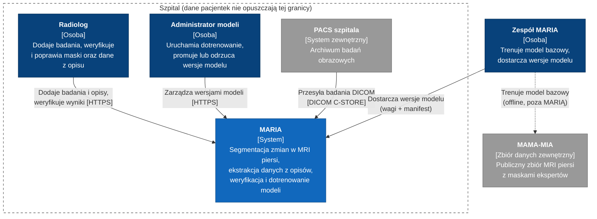
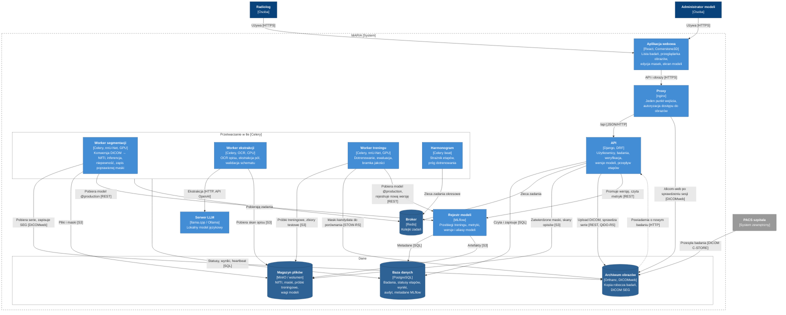
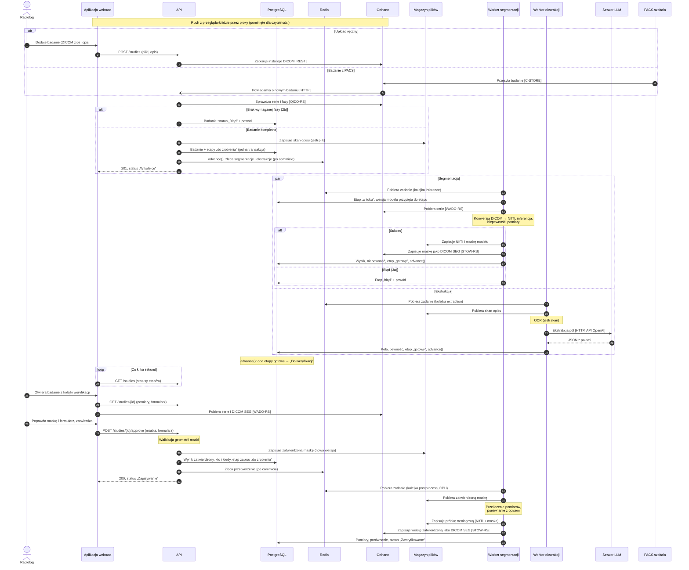
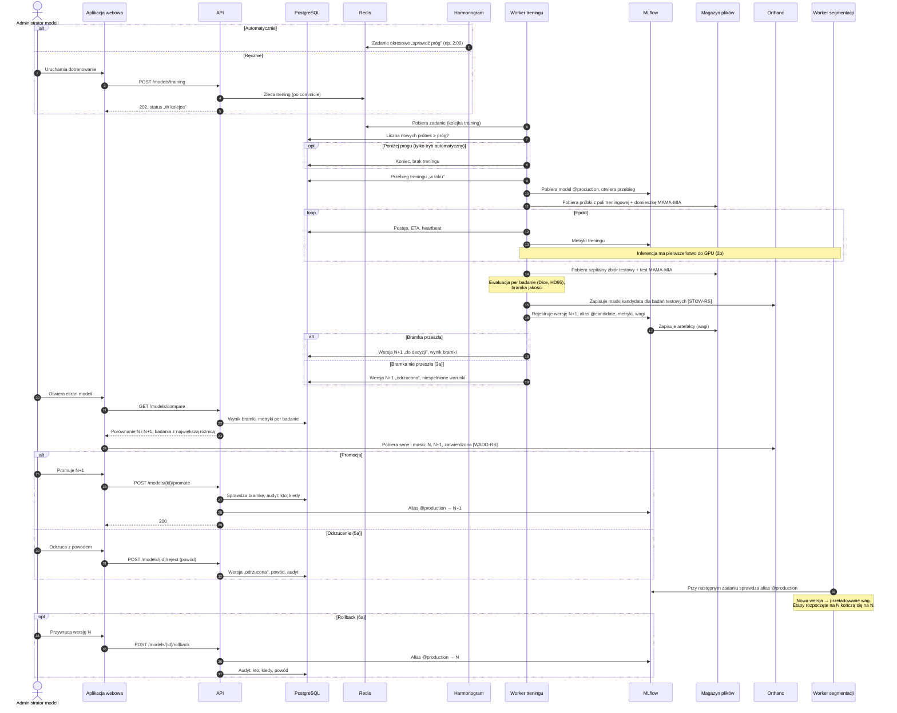

## Cel i zakres

### Cel

Stworzenie narzędzia łączącego przechowywanie badań obrazowych, automatyczną segmentację i przegląd wyników w przeglądarce.

### Zakres

W zakresie:

- dodawanie badań MRI piersi (seria DCE) ręcznie albo z PACS szpitala, wraz z opisem radiologicznym (tekst lub skan),
- automatyczna segmentacja zmiany (nnU-Net) z pomiarami (objętość, wymiary) i oceną niepewności,
- ekstrakcja ustrukturyzowanych danych z opisu (BI-RADS, lokalizacja, wymiar, kształt, brzegi, krzywa) lokalnym modelem językowym,
- weryfikacja i poprawa wyników przez radiologa w przeglądarce, kolejka weryfikacji według niepewności,
- dotrenowanie modelu segmentacji na poprawkach lekarzy, z bramką jakości, ręczną promocją i rollbackiem,
- działanie w całości w infrastrukturze szpitala, w profilach CPU / 1 GPU / 2 GPU.

Poza zakresem:

- diagnoza i użycie kliniczne: system służy wyłącznie do celów badawczych (research use only), nie jest wyrobem medycznym,
- integracja z HIS/RIS (opisy dodawane ręcznie),
- obsługa wielu szpitali w jednej instalacji,
- inne modalności niż MRI piersi (mammografia, USG) po stronie obrazów,
- trening modelu bazowego: odbywa się offline u zespołu, poza systemem.

## Drivery

| ID  | Atrybut                     | Skrót                                                        | Priorytet |
| --- | --------------------------- | ------------------------------------------------------------ | --------- |
| Q1  | Prywatność                  | Dane pacjentek nie opuszczają szpitala, brak PII w logach    | (H, H)    |
| Q2  | Spójność trening–inferencja | Model zespołu daje w szpitalu ten sam wynik                  | (H, H)    |
| Q3  | Niezawodność                | Awaria workera nie gubi pracy lekarza                        | (H, M)    |
| Q4  | Kontrolowana zmiana modelu  | Nowa wersja tylko przez bramkę i decyzję człowieka, rollback | (H, M)    |
| Q5  | Audytowalność               | Dla każdego wyniku wiadomo, skąd pochodzi i kto go zmienił   | (M, M)    |
| Q6  | Czas do wyniku              | Badanie gotowe do weryfikacji w kilka minut                  | (M, L)    |

### P1. Badanie od dodania do weryfikacji

Radiolog dodaje badanie z opisem, system w tle segmentuje zmianę i wyciąga dane z opisu, a radiolog weryfikuje i poprawia wynik.

### P2. Dotrenowanie modelu z poprawek i promocja nowej wersji

System dotrenowuje model na poprawkach lekarzy, ocenia go bramką jakości, a administrator modeli promuje nową wersję albo ją odrzuca.

Pełny opis przepływów i atrybutów jakości: [architecture-drivers.md](architecture-drivers.md).

## C1

## C2

## Sequences

### P1

### P2

