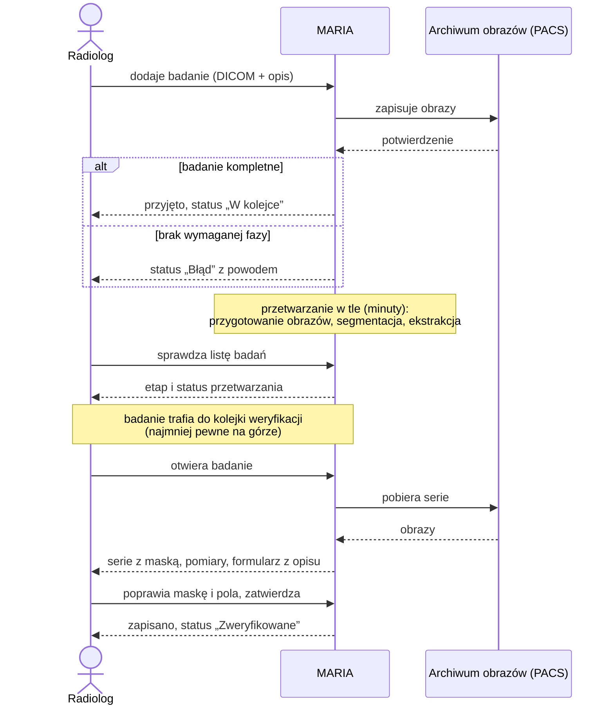
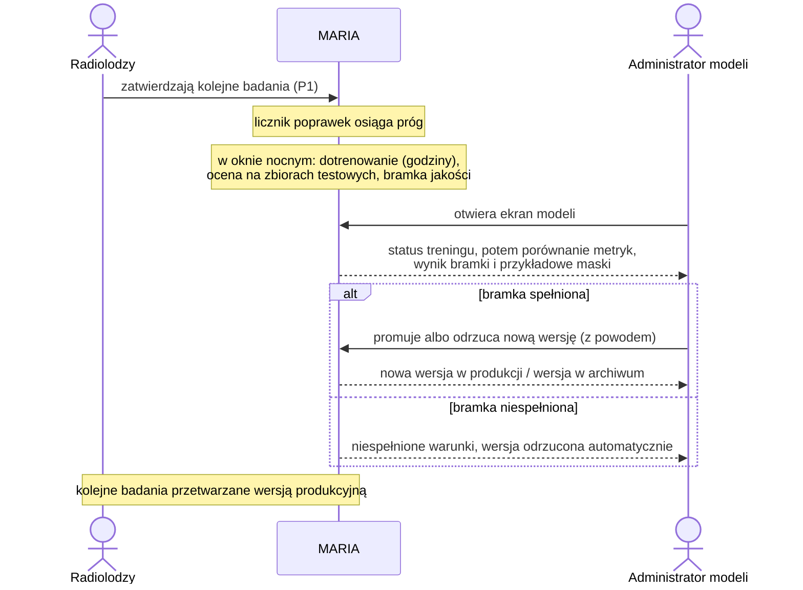

# Drivery architektury

### P1. Badanie od dodania do weryfikacji

Jako radiolog chcę dodać badanie MRI piersi wraz z opisem i dostać do sprawdzenia maskę zmiany, jej objętość i wymiary oraz dane wyciągnięte z opisu, żeby nie obrysowywać i nie mierzyć zmian ręcznie, skrócić czas oceny i uzyskać powtarzalne pomiary.

**Warunek wstępny:** użytkownik jest zalogowany i ma uprawnienie do dodawania i weryfikacji badań; w systemie są aktywne (produkcyjne) modele segmentacji i ekstrakcji.

**Kroki (ścieżka główna):**

1. Użytkownik dodaje badanie: pliki DICOM serii DCE (np. archiwum zip) oraz/lub treść opisu radiologicznego, i wysyła je do analizy.
2. System zapisuje obrazy w archiwum obrazów (PACS), sprawdza, czy badanie ma wymagane fazy (przed kontrastem i po kontraście), i potwierdza przyjęcie. Badanie pojawia się na liście ze statusem „W kolejce”.
3. System przetwarza badanie w tle, etapami: przygotowanie obrazów, segmentacja zmiany, ekstrakcja danych z opisu. Użytkownik nie musi czekać przy ekranie; na liście badań widzi bieżący etap i jego status.
4. Po przetworzeniu badanie trafia do kolejki weryfikacji, uporządkowanej według niepewności modelu: najmniej pewne wyniki są na górze.
5. Użytkownik otwiera badanie i widzi serie (przed kontrastem, po kontraście, subtrakcja) z nałożoną maską, objętość i wymiary zmiany oraz formularz z polami wyciągniętymi z opisu (BI-RADS, lokalizacja, wymiar, kształt, brzegi, krzywa). Pola, w których model i reguły dają różne wyniki, są oznaczone do sprawdzenia.
6. Użytkownik poprawia maskę (pędzel, gumka) i pola formularza albo potwierdza je bez zmian, po czym zatwierdza badanie.
7. System zapisuje wynik zatwierdzony obok wyniku modelu, przelicza pomiary z zatwierdzonej maski, porównuje je z danymi z opisu i zapamiętuje, kto i kiedy zweryfikował badanie oraz które wersje modeli zostały użyte. Badanie otrzymuje status „Zweryfikowane”, a poprawki są liczone jako dane do dotrenowania modeli (P2).

**Wynik:** zweryfikowane badanie z maską, pomiarami, danymi z opisu i porównaniem obraz–opis, dostępne do przeglądu i do wykorzystania w treningu.

**Ścieżki alternatywne i błędy:**

- 1a. Badanie bez opisu (same obrazy): przetwarzanie obejmuje tylko przygotowanie obrazów i segmentację; w kroku 5 formularz z opisu jest pusty i można go uzupełnić ręcznie albo dołączyć opis później (do ustalenia – otwarte pytania).
- 1b. Sam opis bez obrazów: system wykonuje tylko ekstrakcję; weryfikacja obejmuje wyłącznie formularz. Przy dużej liczbie opisów to kandydat na osobny przepływ (hurtowa ekstrakcja).
- 2a. Brak połączenia z archiwum obrazów: system pokazuje błąd i pozwala ponowić wysyłanie; badanie nie zostaje zapisane częściowo.
- 2b. Badanie niekompletne lub niejednoznaczne (brak wymaganej fazy albo kilka serii pasujących do jednej fazy): status „Błąd” z podanym powodem; przetwarzanie nie startuje.
- 3a. Błąd na jednym z etapów przetwarzania: badanie pojawia się w sekcji „Wymaga uwagi” z nazwą etapu i powodem; po usunięciu przyczyny przetwarzanie można ponowić od tego etapu.
- 6a. Użytkownik pomija badanie („Pomiń”): badanie wraca do kolejki bez zmian.

**Dlaczego istotny architektonicznie:**

- **Przechodzi przez prawie cały system:** interfejs z przeglądarką obrazów, API, przetwarzanie w tle, archiwum obrazów, bazę danych i oba modele.
- **Asynchroniczny i wieloetapowy:** przetwarzanie trwa minuty, każdy etap ma własny status, a błędy muszą być widoczne i ponawialne od miejsca awarii. Potrzebny jest trwały stan przetwarzania badania.
- **System zewnętrzny:** archiwum obrazów (PACS). Obecnie Orthanc uruchamiany razem z MARIĄ, docelowo może to być PACS szpitala.
- **Dane wrażliwe:** obrazy i opisy pacjentek. W interfejsie widoczne są tylko identyfikator i wiek.
- **Edycja maski w przeglądarce:** poprawiona maska musi zostać zapisana i wrócić do pomiarów oraz do treningu.
- **Dane pochodne:** seria subtrakcyjna i pomiary zmiany muszą być liczone w jednym miejscu, tym samym kodem co w treningu.
- **Niepewność modelu** powstaje przy inferencji i musi być zapisana razem z wynikiem, bo steruje kolejnością weryfikacji.
- **Związek z treningiem:** wynik modelu, wynik zatwierdzony i wersje modeli to dane dla aktywnego uczenia (P2).

**Powiązane atrybuty jakości:** Q1, Q2, Q3, Q5, Q6

**Źródło:** makiety `docs/design/mockups/03`–`07`, `11`. **Powiązane:** #9, #16, #17, #18, #20–#25, PR #33.

### P2. Dotrenowanie modelu z poprawek i promocja nowej wersji

Jako administrator modeli chcę, żeby system dotrenowywał model na poprawkach lekarzy i pokazywał mi porównanie nowej wersji z obecną, żeby wdrażać tylko wersje, które działają lepiej na danych szpitala, i nie dopuścić do pogorszenia wyników.

**Warunek wstępny:** dotrenowanie jest włączone w konfiguracji wdrożenia (dostępny GPU, zgoda szpitala na użycie danych); istnieje model produkcyjny; część zweryfikowanych badań jest na stałe wydzielona jako szpitalny zbiór testowy i nigdy nie trafia do treningu.

**Kroki (ścieżka główna):**

1. Gdy liczba nowych zweryfikowanych badań przekroczy próg ustalony przez administratora modeli, system uruchamia dotrenowanie w najbliższym oknie, w którym nie jest używany (np. w nocy). Administrator może też uruchomić trening ręcznie.
2. System dotrenowuje obecny model produkcyjny na poprawkach z domieszką danych MAMA-MIA. Na ekranie modeli widać status treningu i szacowany pozostały czas.
3. Po zakończeniu treningu system ocenia nową wersję na stałym zbiorze testowym szpitala i na zbiorze testowym MAMA-MIA, a następnie sprawdza bramkę jakości: nowa wersja musi być lepsza od obecnej na danych szpitala, nie gorsza na MAMA-MIA i bez drastycznego pogorszenia na pojedynczych badaniach.
4. Administrator modeli widzi porównanie metryk (Dice, HD95) obecnej i nowej wersji, wynik bramki jakości oraz kilka badań testowych, w których obie wersje różnią się najbardziej, z nałożonymi maskami: obecnego modelu, nowej wersji i zatwierdzoną przez lekarza.
5. Administrator modeli promuje nową wersję albo ją odrzuca, podając powód.
6. Po promocji nowe badania są przetwarzane nową wersją; badania już przetwarzane kończą się na poprzedniej. Dotychczasowe wyniki zachowują informację, którą wersją powstały. Poprzednia wersja trafia do archiwum i można do niej wrócić.

**Wynik:** w produkcji działa wersja, która przeszła bramkę jakości i została zatwierdzona przez człowieka; wszystkie wersje (także odrzucone) pozostają w rejestrze z metrykami, danymi treningowymi i powodem decyzji.

**Ścieżki alternatywne i błędy:**

- 1a. Dotrenowanie wyłączone (brak GPU, brak zgody szpitala albo brak administratora modeli): licznik poprawek i przycisk treningu są niedostępne; nowe wersje modelu dostarcza zespół (kandydat na kolejny przepływ, Q2).
- 2a. Trening kończy się błędem: status „Błąd” z powodem; model produkcyjny działa bez zmian; administrator może ponowić trening.
- 2b. W trakcie treningu przychodzi badanie do analizy (P1): przetwarzanie badań ma pierwszeństwo przed treningiem.
- 3a. Nowa wersja nie przechodzi bramki: administrator widzi, które warunki nie zostały spełnione; promocja jest niedostępna, a wersja zostaje automatycznie oznaczona jako odrzucona.
- 5a. Administrator odrzuca wersję: trafia do archiwum z podanym powodem; nic nie jest usuwane.
- 6a. Po promocji okazuje się, że nowa wersja działa gorzej (np. lekarze częściej poprawiają maski): administrator przywraca poprzednią wersję (rollback).

**Dlaczego istotny architektonicznie:**

- **Inny kontener i długie zadania:** trening trwa godziny i działa w `worker-training`, osobno od przetwarzania badań.
- **Współdzielenie zasobów:** przy jednym GPU trening i inferencja konkurują o kartę; potrzebne są priorytety, okno czasowe i limit współbieżności.
- **Rejestr modeli i przełączanie wersji:** inferencja ładuje „aktualny model produkcyjny” z rejestru; promocja i rollback bez restartu i bez przerywania trwających zadań.
- **Ewaluacja per badanie:** zapisywane są metryki i maski nowej wersji dla każdego badania testowego, nie tylko średnie; przeglądarka musi pokazać maskę z wersji nieprodukcyjnej.
- **Podział danych:** przydział badania do puli treningowej albo do zbioru testowego zapada raz, przy zatwierdzeniu, i nigdy się nie zmienia; badanie może też być wyłączone z treningu.
- **Dane tylko w szpitalu:** trening na poprawkach odbywa się na infrastrukturze szpitala.
- **Profile wdrożenia:** dotrenowanie musi dać się wyłączyć konfiguracją bez zmian w kodzie.
- **Uprawnienia:** tylko rola administratora może uruchamiać trening i promować wersje.
- **Spójność z treningiem bazowym:** ten sam kod treningu co przy treningu offline na MAMA-MIA.

**Model ekstrakcji:** przepływ jest analogiczny (makieta 09, metryki F1), ale mechanizm „dotrenowania” ekstraktora opartego na LLM jest do ustalenia (otwarte pytania).

**Powiązane atrybuty jakości:** Q1, Q2, Q3, Q4, Q5

**Źródło:** makiety `docs/design/mockups/08`, `09`, `11`. **Powiązane:** #22, #23, #25, PR #33.

## Kandydaci na kolejne przepływy (do potwierdzenia)

- Dostarczenie wersji modelu od zespołu (import, sprawdzenie zgodności, bramka).
  Na razie pokryte przez Q2 i ograniczenie „model bazowy trenowany offline”.
- Hurtowa ekstrakcja z historycznych opisów (czeka na odpowiedź opiekunki).

## Atrybuty jakości (w kolejności ważności)

Priorytet: (ważność dla projektu, trudność architektoniczna), skala H/M/L.
Progi w miarach są propozycją do potwierdzenia z zespołem i opiekunką.

| ID  | Atrybut                     | Skrót                                                        | Priorytet |
| --- | --------------------------- | ------------------------------------------------------------ | --------- |
| Q1  | Prywatność                  | Dane pacjentek nie opuszczają szpitala, brak PII w logach    | (H, H)    |
| Q2  | Spójność trening–inferencja | Model zespołu daje w szpitalu ten sam wynik                  | (H, H)    |
| Q3  | Niezawodność                | Awaria workera nie gubi pracy lekarza                        | (H, M)    |
| Q4  | Kontrolowana zmiana modelu  | Nowa wersja tylko przez bramkę i decyzję człowieka, rollback | (H, M)    |
| Q5  | Audytowalność               | Dla każdego wyniku wiadomo, skąd pochodzi i kto go zmienił   | (M, M)    |
| Q6  | Czas do wyniku              | Badanie gotowe do weryfikacji w kilka minut                  | (M, L)    |

### Q1. Prywatność (H, H)

- **Given:** wdrożenie w szpitalu (faza B), normalna praca albo błąd dowolnego etapu
- **When:** system przetwarza badanie i opis (P1, w tym OCR i ekstrakcja LLM) albo dotrenowuje model (P2)
- **Then:** obrazy, opisy, tekst po OCR i maski nie opuszczają infrastruktury szpitala; danych osobowych (imię i nazwisko, PESEL, treść opisu) nie ma w logach, komunikatach błędów ani w MLflow; LLM jest wywoływany tylko na dozwolonych hostach
- **Miara:** system przechodzi P1 i P2 przy zablokowanym dostępie do internetu; 0 połączeń wychodzących poza listę dozwolonych hostów; automatyczny test na danych testowych nie znajduje PESEL ani nazwisk w logach i w MLflow
- **Powiązane:** P1, P2, ograniczenia prawne (RODO art. 9)

### Q2. Spójność trening–inferencja (H, H)

- **Given:** model bazowy wytrenowany offline przez zespół na MAMA-MIA i dostarczony do MARII
- **When:** MARIA uruchamia inferencję na przypadku, który zespół przetworzył u siebie
- **Then:** wynik jest taki sam jak u zespołu; preprocessing (konwersja DICOM → NIfTI, kolejność kanałów, normalizacja, subtrakcja) ma jedną implementację, używaną w treningu i w inferencji; model niezgodny z wersją preprocessingu nie zostaje uruchomiony
- **Miara:** Dice ≥ 0,99 względem wyniku zespołu na 3 przypadkach referencyjnych (test automatyczny); wersja preprocessingu zapisana przy modelu jest zgodna z wersją w systemie, w przeciwnym razie import jest odrzucany
- **Powiązane:** P1 (kroki 3, 7), P2 (krok 2), kandydat: dostarczenie wersji modelu od zespołu

### Q3. Niezawodność (H, M)

- **Given:** normalna praca; badanie jest przetwarzane albo radiolog właśnie zatwierdził poprawioną maskę
- **When:** worker przestaje działać w trakcie zadania (restart kontenera, brak pamięci GPU, błąd modelu)
- **Then:** zatwierdzona maska i formularz pozostają zapisane; etap dostaje status „Błąd” z powodem albo zostaje ponowiony; po ponowieniu powstaje dokładnie jeden wynik; pozostałe badania przetwarzają się dalej
- **Miara:** 0 utraconych zatwierdzonych wyników; wykrycie zawieszonego etapu ≤ 5 min; 0 zduplikowanych wyników po ponowieniu
- **Powiązane:** P1 (kroki 3, 7, ścieżka 3a), P2 (ścieżka 2a)

### Q4. Kontrolowana zmiana modelu (H, M)

- **Given:** w produkcji działa model w wersji N, w systemie trwa przetwarzanie badań
- **When:** pojawia się nowa wersja N+1 (z dotrenowania albo od zespołu) albo administrator chce wrócić do wersji N−1
- **Then:** wersja trafia do użycia tylko po przejściu bramki jakości i decyzji administratora; przełączenie nie wymaga restartu systemu i nie przerywa trwających zadań (badanie rozpoczęte na wersji N kończy się na wersji N); poprzednie wersje pozostają dostępne do rollbacku
- **Miara:** 0 promocji z pominięciem bramki; rollback ≤ 5 min z poziomu interfejsu; 0 badań przetworzonych mieszanką wersji
- **Powiązane:** P2 (kroki 3–6, ścieżki 3a, 6a)

### Q5. Audytowalność (M, M)

- **Given:** zweryfikowane badanie albo wersja modelu w rejestrze
- **When:** ktoś pyta „skąd ten wynik?” (kontrola, analiza błędu, publikacja)
- **Then:** dla wyniku widać wersję modelu i preprocessingu, serie wejściowe, wynik modelu i wynik zatwierdzony, kto i kiedy go zweryfikował lub poprawił; dla wersji modelu widać dane treningowe, metryki, wynik bramki oraz kto i dlaczego ją promował lub odrzucił
- **Miara:** 100% wyników i wersji modeli ma komplet tych informacji; odpowiedź z poziomu interfejsu albo jednego zapytania, bez przeglądania logów; wpisów audytu nie da się edytować
- **Powiązane:** P1 (krok 7), P2 (kroki 5–6), Q1 (audyt bez danych osobowych)

### Q6. Czas do wyniku (M, L)

- **Given:** profil z 1 GPU, do 5 radiologów pracujących jednocześnie, trening nie trwa
- **When:** radiolog dodaje badanie
- **Then:** badanie trafia do kolejki weryfikacji bez udziału użytkownika; interfejs pozostaje responsywny w trakcie przetwarzania
- **Miara:** od dodania do statusu „Do weryfikacji” ≤ 10 min na badanie (profil CPU: ≤ 60 min); odpowiedzi API < 1 s (p95); otwarcie badania w przeglądarce obrazów < 5 s
- **Powiązane:** P1 (kroki 2–5), P2 (ścieżka 2b: pierwszeństwo inferencji przed treningiem)

## Ograniczenia

Decyzje już podjęte lub narzucone z zewnątrz (technologia, zespół, czas, sprzęt, prawo).

- …

## Poza zakresem

- …

## Otwarte pytania

Pytanie · od czego zależy · kto rozstrzyga.

- Kto dodaje badania: radiolog, technik czy inna rola? Czy docelowo badania mają przychodzić automatycznie z PACS szpitala? · uprawnienia, integracja z PACS · zespół + opiekunka
- Czy obrazy i opis mogą dochodzić osobno i w dowolnej kolejności? Czy opis można dołączyć do badania później? Kiedy startuje przetwarzanie? · stany badania, reguła startu przetwarzania · zespół (Patrycja – makiety)
- Czy w jednym badaniu może być więcej niż jedna zmiana? · model danych (PR #33), pomiary, interfejs · zespół + opiekunka
- Czy użytkownik może odrzucić wynik modelu w całości (maska zupełnie błędna, brak zmiany)? · statusy badania, dane do treningu · zespół
- Gdzie i w jakim formacie zapisujemy poprawioną maskę (DICOM SEG w Orthanc czy plik w backendzie)? · edycja w OHIF, trening, pomiary · ARCH-1
- Kto w szpitalu będzie administratorem modeli (fizyk medyczny, dział nauki, IT, nikt)? · czy P2 jest w MVP · opiekunka + szpital
- Czy promocja modelu wymaga akceptacji klinicznej (radiolog lub kierownik)? · role, kroki P2 · szpital
- Czy administrator może wymusić promocję mimo niespełnionej bramki jakości? · uprawnienia, audyt · zespół (rekomendacja: nie)
- Czym jest „dotrenowanie” modelu ekstrakcji (fine-tuning LLM, przykłady few-shot, reguły)? · koszt obliczeń, architektura P2 dla ekstrakcji · Kacper Janiszewski
- Czy ekran modeli pokazuje przykładowe maski nowej wersji? · makieta 08 · Patrycja

## Systemowe diagramy sekwencji (poziom 1)

MARIA jako czarna skrzynka: tylko użytkownicy, system i systemy zewnętrzne.
Wersje z kontenerami i modułami powstają przy porównywaniu opcji architektury (ARCH-1).

### P1. Badanie od dodania do weryfikacji

### P2. Dotrenowanie modelu z poprawek i promocja nowej wersji

