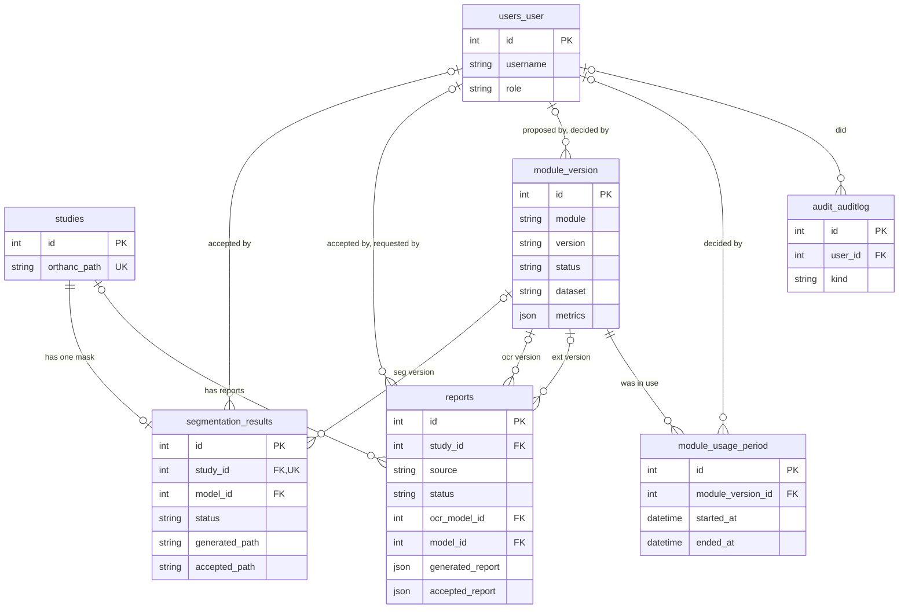

# Database schema

This is the binding schema of the application database. The code is being migrated to it; where
a model in `backend/` still differs, this document is the target and the difference is listed in
[Differences from the current code](#4-differences-from-the-current-code).

## 1. PostgreSQL tables

The same database also holds the tables of MLflow (`model_versions`, `registered_models`, `runs`,
...). They belong to MLflow and are not described here; application tables must not reuse their names.

### `studies`

A study in the Orthanc PACS. Images and patient data stay in Orthanc.

| Column | Type | Description |
| :--- | :--- | :--- |
| `id` | integer (PK) | |
| `orthanc_path` | varchar, unique | Orthanc's id of the study. |

### `reports`

One row per report through its whole life: uploaded, processed (OCR, then LLM), verified by a
radiologist. A report has one result; processing it again overwrites the result unless it is verified.

| Column | Type | Description |
| :--- | :--- | :--- |
| `id` | integer (PK) | |
| `study_id` | integer (FK → `studies`), nullable | Empty for a report without a study. Set to empty when the study is deleted. |
| `report_path` | varchar, nullable | Key of the file in the MinIO `reports` bucket. Empty for a manual report. |
| `source` | varchar | `scan` (image or PDF, read by OCR), `text` (.txt, no OCR), `manual` (form filled in by the radiologist, no file). Set by the backend. |
| `assigned_at` | datetime | When the report was assigned to its study. The active report of a study is the one assigned last. |
| `status` | varchar | `UPLOADED` → `PENDING` → `PROCESSING` → `COMPLETED` or `FAILED`; after review `APPROVED`, `CORRECTED` or `REJECTED`. |
| `failed_step` | varchar | `ocr` or `llm`: the step that failed. |
| `error` | text | Why the processing failed; never contains report text. |
| `ocr_model_id` | integer (FK → `module_version`, module `ocr`) | Empty for `text` and `manual`. |
| `ocr_text` | text | The normalised report text that was sent to the LLM. |
| `ocr_confidence` | float | Mean confidence of the OCR read. |
| `ocr_seconds` | float | |
| `ocr_engine_version` | varchar | Version of the OCR library at the time of the read. |
| `page_rotations` | json | Rotation detected for each page. |
| `model_id` | integer (FK → `module_version`, module `ext`) | Empty for `manual`. |
| `generated_report` | json | The form filled in by the model, in the worker schema (`workers/extraction/schema.py`). |
| `uncertainty` | float | How much to doubt the result, 0–1. |
| `warnings` | json | Fields of `generated_report` that do not follow from the report text. |
| `llm_seconds` | float | |
| `attempts` | integer | LLM attempts needed for a valid answer. |
| `schema_version` | varchar | Version of the form schema `generated_report` and `accepted_report` follow. |
| `accepted_report` | json | The form approved by the radiologist, same schema as `generated_report`. |
| `field_checks` | json | The radiologist's check of each field by its path in the form: `{"zmiany.0.birads": "confirmed" \| "corrected" \| "unverified"}`. |
| `accepted_by_id` | integer (FK → `users_user`) | |
| `accepted_at` | date | |
| `requested_by_id` | integer (FK → `users_user`) | Who ordered the processing. |
| `created_at` | datetime | When the report was uploaded or the manual form was saved. |
| `updated_at` | datetime | Last change; lets a stage stuck in `PROCESSING` be detected. |

The JSON columns hold one document each, written and read as a whole; its shape is checked by the
schema in code, not by the database.

### `segmentation_results`

The mask of a study. A study has at most one.

| Column | Type | Description |
| :--- | :--- | :--- |
| `id` | integer (PK) | |
| `study_id` | integer (FK → `studies`), unique | Deleted together with the study. |
| `model_id` | integer (FK → `module_version`, module `seg`) | |
| `status` | varchar | `PENDING` → `PROCESSING` → `COMPLETED` or `FAILED`; after review `APPROVED`, `CORRECTED` or `REJECTED`. |
| `error` | text | Why the segmentation failed. |
| `uncertainty` | float | |
| `generated_path` | varchar | Mask of the model in the MinIO `masks` bucket. |
| `accepted_path` | varchar | Mask approved or corrected by the radiologist. |
| `input_series_ids` | json | Orthanc series used as the input. |
| `model_seg_series_uid`, `model_seg_sop_uid` | varchar | DICOM SEG of the model mask in Orthanc. |
| `approved_seg_series_uid`, `approved_seg_sop_uid` | varchar | DICOM SEG of the approved mask in Orthanc. |
| `measurements` | json | `volume_ml` and `dimensions_mm` of the model mask. |
| `accepted_by_id` | integer (FK → `users_user`) | |
| `accepted_at` | date | |
| `created_at`, `updated_at` | datetime | |

### `module_version`

A version of one processing module. Three kinds of version share the table; the columns of the
other kinds stay empty. A version can be edited only in status `new`; once proposed it does not change.

| Column | Type | Module | Description |
| :--- | :--- | :--- | :--- |
| `id` | integer (PK) | all | |
| `module` | varchar | all | `seg` (segmentation model), `ocr` (OCR engine and settings), `ext` (LLM, prompt and few-shot examples). |
| `name` | varchar | all | |
| `version` | varchar | all | Unique together with `module`. |
| `status` | varchar | all | `new`, `training`, `candidate`, `production`, `archived`, `rejected`. |
| `proposed_by_id` | integer (FK → `users_user`) | all | |
| `proposed_at` | datetime | all | |
| `reason` | text | all | Reason of the proposal or the decision. |
| `restore` | boolean | all | The proposal brings back an archived version. |
| `decided_by_id` | integer (FK → `users_user`) | all | Who promoted or rejected the version. |
| `ocr_engine` | varchar | `ocr` | |
| `ocr_settings` | json | `ocr` | `{"lang", "orientation", "unwarp", "detect_orientation"}`. |
| `llm_model` | varchar | `ext` | |
| `prompt_version` | varchar | `ext` | |
| `structured_output` | boolean | `ext` | Whether the LLM is forced to answer in the form schema. |
| `few_shot_examples` | json | `ext` | List of `{report, output}`; the whole set is one value, as it goes into the prompt. |
| `trained_at` | datetime | `seg` | |
| `training_cases` | integer | `seg` | |
| `celery_task_id` | varchar | `seg` | Lets a running training be stopped. |
| `dataset` | varchar | all | Name of the set the version was trained on and its metrics were computed on; written by the worker. |
| `metrics` | json | all | See below. |
| `metrics_cases` | integer | all | Number of cases the metrics were computed on. |
| `mlflow_run_id` | varchar | all | |
| `created_at` | datetime | all | |

Keys of `metrics`:

| Module | Keys |
| :--- | :--- |
| `seg` | `dice`, `iou`, `dice_small`, `volume_error_pct` |
| `ocr` | `cer`, `word_error`, `worst_cer`, `mean_confidence`, `seconds_per_page` |
| `ext` | `field_accuracy` (per field), `f1`, `precision`, `recall` |

### `module_usage_period`

When a version was in use. A restored version has more than one period. At most one period per
module is open at a time; it changes in one transaction with `module_version.status`.

| Column | Type | Description |
| :--- | :--- | :--- |
| `id` | integer (PK) | |
| `module_version_id` | integer (FK → `module_version`) | |
| `started_at` | datetime | |
| `ended_at` | datetime, nullable | Empty while the version is in use. |
| `decided_by_id` | integer (FK → `users_user`) | |

### `users_user`

The Django user (`username`, `password`, `first_name`, `last_name`, `email`, `is_active`, ...) with:

| Column | Type | Description |
| :--- | :--- | :--- |
| `role` | varchar | `radiologist`, `researcher`, `admin`. |
| `is_first_login` | boolean | The user has to change the password. |
| `pwz` | varchar, unique | Medical licence number. |

### `audit_auditlog`

| Column | Type | Description |
| :--- | :--- | :--- |
| `id` | integer (PK) | |
| `timestamp` | datetime | |
| `user_id` | integer (FK → `users_user`) | |
| `fallback_login`, `fallback_name` | varchar | Who it was, kept when the account is gone or the login failed. |
| `kind` | varchar | Kind of event (`audit/models.py`). |
| `object` | varchar | What the event was about. |
| `detail` | text | |
| `ip_address` | inet | |

### Relations

| Relation | Kind | When the parent is deleted |
| :--- | :--- | :--- |
| `studies` → `segmentation_results` | 1 : 0..1 | the mask is deleted |
| `studies` → `reports` | 1 : N | the report stays, without a study |
| `module_version` → `segmentation_results` | 1 : N | the field is emptied |
| `module_version` → `reports` (`ocr_model_id`, `model_id`) | 1 : N each | the field is emptied |
| `module_version` → `module_usage_period` | 1 : N | the periods are deleted |
| `users_user` → `reports`, `segmentation_results`, `module_version`, `module_usage_period`, `audit_auditlog` | 1 : N | the field is emptied |

### Rules the schema relies on

* A report belongs to at most one study. A study can have several reports; the one assigned last is active.
* Uploading a report computes nothing. Processing starts on demand and when the report is assigned to a study.
* A verified mask or report form is never replaced. A result that is not verified is overwritten by a new run.
* A study is closed when both its mask and its active report form are verified.
* A new version is compared with the one in use in one run on the same cases; those runs go to MLflow, not to these tables.
* Forms filled in by hand (`source = manual`) are not counted in the extraction statistics.

## 2. Orthanc PACS

* **Linked from:** `studies.orthanc_path`, and the DICOM SEG UIDs in `segmentation_results`.
* **Stores:** raw DICOM files, patient personal data and the masks as DICOM SEG.

## 3. MinIO object storage

| Bucket | Linked by | Description |
| :--- | :--- | :--- |
| `masks` | `segmentation_results.generated_path`, `segmentation_results.accepted_path` | Masks of the model and masks approved or corrected by the radiologist. |
| `reports` | `reports.report_path` | Uploaded report files (scans and text). |
| `mlflow` | `module_version.mlflow_run_id` | Model weights and artifacts, managed by MLflow. |

## 4. Differences from the current code

| Target | Today |
| :--- | :--- |
| `reports.failed_step` | missing |
| OCR and LLM columns of `reports` (`ocr_model_id`, `ocr_*`, `page_rotations`, `llm_seconds`, `attempts`, `schema_version`) | inside the JSON columns `result` and `provenance` |
| `module_version` configuration: `ocr_engine`, `ocr_settings`, `llm_model`, `prompt_version`, `structured_output`, `few_shot_examples` | missing; the worker reads them from files and environment variables |
| `seg` keys of `metrics`: `dice`, `iou`, `dice_small`, `volume_error_pct` | the comment in `mlops/models.py` also lists `hd95` |
