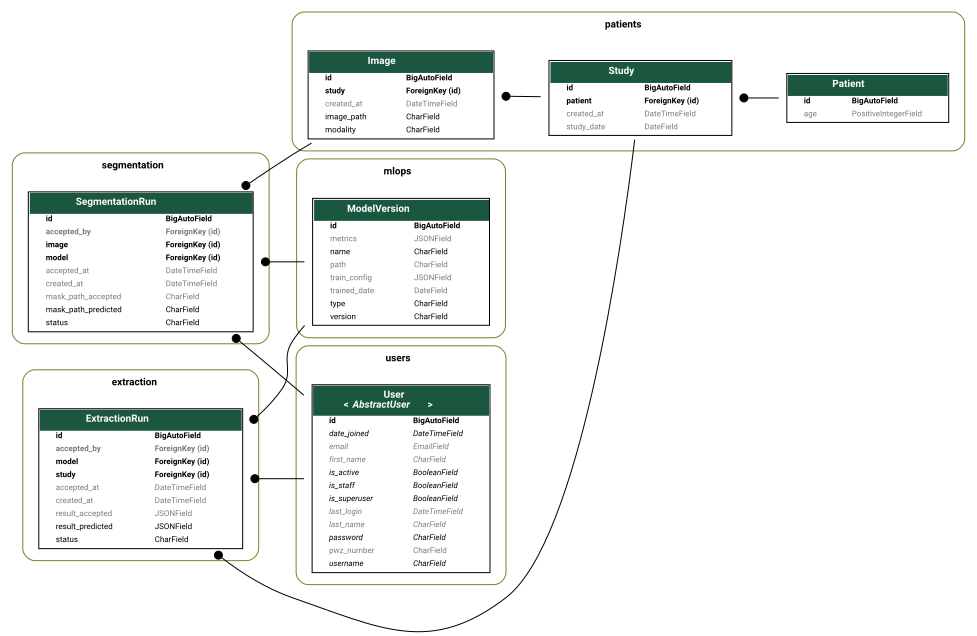

## 1. PostgreSQL / Database Tables

### User Table
| Field Name | Data Type | Description |
| :--- | :--- | :--- |
| **id** | integer (PK) | Unique primary key for each user account. |
| **username** | varchar | username used to log into the application. |
| **email** | varchar | User's email address for notifications and account recovery. |
| **password** | varchar | Securely hashed password string. |
| **pwz** | varchar | Medical license number (PWZ), critical for official medical report auditing. |
| **name** | varchar | First name of the user. |
| **surname** | varchar | Last name of the user. |
| **role** | varchar / enum | Defines user permissions within the system (e.g., admin, radiologist, head_physician). |

---

### Study Table
| Field Name | Data Type | Description |
| :--- | :--- | :--- |
| **id** | integer (PK) | Unique primary key for the medical study record. |
| **orthanc_path** | varchar | Unique identifier (Study Instance UID) referencing the study in the Orthanc PACS server. Used to fetch DICOM files and patient metadata on-the-fly. |

---

### ModelVersion Table
| Field Name | Data Type | Description |
| :--- | :--- | :--- |
| **id** | integer (PK) | Unique primary key for the AI model registry track. |
| **name** | varchar | Technical name of the AI model architecture |
| **version** | varchar | Semantic version string managed by MLflow (e.g., v1.2.0). |
| **recall** | float | Evaluation metric indicating the true positive rate achieved during model validation. |
| **accuracy** | float | Evaluation metric indicating the overall correctness of the model. |
| **path** | varchar | Storage URI pointing to the model weights archive managed by MLflow inside MinIO. |
| **created_at** | date | Timestamp recording when this specific model version was registered. |

---

### SegmentationResult Table
| Field Name | Data Type | Description |
| :--- | :--- | :--- |
| **id** | integer (PK) | Unique primary key for the AI image segmentation output. |
| **study_id** | integer (FK) | Foreign key mapping to the corresponding Study. |
| **model_id** | integer (FK) | Foreign key tracking which ModelVersion generated this segmentation. |
| **status** | enum / varchar | Current execution state of the worker task (e.g., PENDING, SUCCESS, CORRECTED,FAILED). |
| **uncertainty** | float | Confidence or epistemic uncertainty score returned by the AI model regarding its output. |
| **generated_path** | varchar | Storage path pointing to the raw AI-generated prediction mask stored in MinIO. |
| **accepted_path** | varchar | Storage path pointing to the final verified or manually corrected segmentation mask in MinIO. |
| **accepted_by** | integer (FK) | Foreign key tracking the specific radiologist (User) who audited and verified the mask. |
| **accepted_at** | date | Timestamp recording when the radiologist approved the segmentation results. |

---

### ExtractionResult Table
| Field Name | Data Type | Description |
| :--- | :--- | :--- |
| **id** | integer (PK) | Unique primary key for the structured parameters extraction. |
| **study_id** | integer (FK) | Foreign key mapping to the corresponding Study. |
| **model_id** | integer (FK) | Foreign key tracking which ModelVersion generated this inference report. |
| **status** | enum / varchar | Current state of the processing job (e.g., PENDING, SUCCESS, CORRECTED,FAILED). |
| **uncertainty** | float | Model confidence score associated with the extracted parameters. |
| **generated_report** | json | Flexible JSON structure storing the raw clinical metrics generated by the AI model. Prevents DB migrations when models evolve. |
| **accepted_report** | json | Flexible JSON structure capturing the final metrics after potential manual corrections or confirmation by the radiologist. |
| **accepted_by** | integer (FK) | Foreign key tracking the radiologist (User) who signed off on the final clinical report. |
| **accepted_at** | date | Timestamp recording when the radiologist approved the clinical metrics. |

## 2. Orthanc PACS
* **Linked from:** `Study.orthanc_path`
* **Stores:** Raw DICOM files and patient personal data (Privacy-by-Design compliance).

## 3. MinIO Object Storage

| Stores | Linked by | Description |
| :--- | :--- | :--- |
| **Segmentation masks** | `SegmentationResult.generated_path` `SegmentationResult.accepted_path` | Binary prediction masks generated by the AI model or corrected by the radiologist from MRI scans. |
| **Model weights** | `ModelVersion.path` | Archived model weights and artifacts for segmentation and extraction tasks, managed via MLflow. |