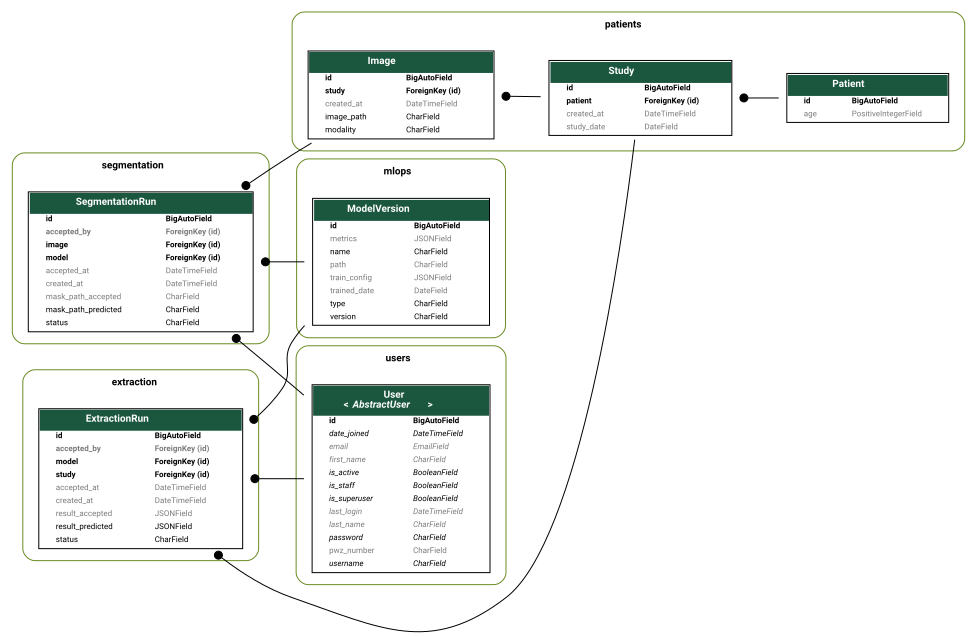

## 1. PostgreSQL / Database Tables

### User Table
| Field Name | Data Type | Description |
| :--- | :--- | :--- |
| **id** | integer (PK) | Unique primary key for each user account. |
| **username** | varchar | username used to log into the application. |
| **email** | varchar | User's email address for notifications and account recovery. |
| **password** | varchar | Securely hashed password string. |
| **pwz** | varchar | Medical license number (PWZ), critical for official medical report auditing. |
| **name** | varchar | First name of the user. |
| **surname** | varchar | Last name of the user. |
| **role** | varchar / enum | Defines user permissions within the system (e.g., admin, radiologist, head_physician). |

---

### Study Table
| Field Name | Data Type | Description |
| :--- | :--- | :--- |
| **id** | integer (PK) | Unique primary key for the medical study record. |
| **orthanc_path** | varchar | Unique identifier (Study Instance UID) referencing the study in the Orthanc PACS server. Used to fetch DICOM files and patient metadata on-the-fly. |

---

### ModelVersion Table
| Field Name | Data Type | Description |
| :--- | :--- | :--- |
| **id** | integer (PK) | Unique primary key for the AI model registry track. |
| **name** | varchar | Technical name of the AI model architecture |
| **version** | varchar | Semantic version string managed by MLflow (e.g., v1.2.0). |
| **recall** | float | Evaluation metric indicating the true positive rate achieved during model validation. |
| **accuracy** | float | Evaluation metric indicating the overall correctness of the model. |
| **path** | varchar | Storage URI pointing to the model weights archive managed by MLflow inside MinIO. |
| **created_at** | date | Timestamp recording when this specific model version was registered. |

---

### SegmentationResult Table
| Field Name | Data Type | Description |
| :--- | :--- | :--- |
| **id** | integer (PK) | Unique primary key for the AI image segmentation output. |
| **study_id** | integer (FK) | Foreign key mapping to the corresponding Study. |
| **model_id** | integer (FK) | Foreign key tracking which ModelVersion generated this segmentation. |
| **status** | enum / varchar | Current execution state of the worker task (e.g., PENDING, SUCCESS, CORRECTED,FAILED). |
| **uncertainty** | float | Confidence or epistemic uncertainty score returned by the AI model regarding its output. |
| **generated_path** | varchar | Storage path pointing to the raw AI-generated prediction mask stored in MinIO. |
| **accepted_path** | varchar | Storage path pointing to the final verified or manually corrected segmentation mask in MinIO. |
| **measurements** | json | Measurements of the model mask computed by the worker: `volume_ml` (all voxels) and `dimensions_mm` (extent of the largest region, longest first); null before inference. |
| **accepted_by** | integer (FK) | Foreign key tracking the specific radiologist (User) who audited and verified the mask. |
| **accepted_at** | date | Timestamp recording when the radiologist approved the segmentation results. |

---

### ExtractionResult Table
| Field Name | Data Type | Description |
| :--- | :--- | :--- |
| **id** | integer (PK) | Unique primary key for the structured parameters extraction. |
| **study_id** | integer (FK) | Foreign key mapping to the corresponding Study. |
| **model_id** | integer (FK) | Foreign key tracking which ModelVersion generated this inference report. |
| **status** | enum / varchar | PENDING (uploaded) → PROCESSING (worker started) → COMPLETED or FAILED; after review APPROVED, CORRECTED or REJECTED. |
| **uncertainty** | float | Model confidence score associated with the extracted parameters. |
| **generated_report** | json | Flexible JSON structure storing the raw clinical metrics generated by the AI model. Prevents DB migrations when models evolve. |
| **accepted_report** | json | The report approved by the radiologist, in the worker schema (`workers/extraction/schema.py`); the model report when approved without a form. |
| **lesion_answers** | json | The radiologist's answer per lesion index and field from the review form: `{"0": {"birads": {"value": "4C", "state": "confirmed"}}}`. Any `corrected` answer makes the status CORRECTED. |
| **accepted_by** | integer (FK) | Foreign key tracking the radiologist (User) who signed off on the final clinical report. |
| **accepted_at** | date | Timestamp recording when the radiologist approved the clinical metrics. |
| **report_path** | varchar | Key of the report file (text or scan) in the MinIO `reports` bucket. |
| **error** | text | Why the extraction failed (status FAILED); never contains report text. |
| **warnings** | json | Fields of `generated_report` that do not follow from the report text, from the extractor's checks. |
| **result** | json | The worker's full `ExtractionResult` (`workers/extraction/schema.py`): status, data, OCR text, warnings, provenance, timings; what the frontend shows as the report. Empty while a (re)try runs. |
| **provenance** | json | What produced the result: LLM model, prompt and schema version, OCR engine, page rotation. |
| **created_at** | datetime | When the report was uploaded. |
| **updated_at** | datetime | Last status change; lets a stage stuck in PROCESSING be detected. |
| **assigned_at** | datetime | When the report was assigned to its study (at upload or later). A study can have several reports; the active one is the one assigned last. |

## 2. Orthanc PACS
* **Linked from:** `Study.orthanc_path`
* **Stores:** Raw DICOM files and patient personal data (Privacy-by-Design compliance).

## 3. MinIO Object Storage

| Stores | Linked by | Description |
| :--- | :--- | :--- |
| **Segmentation masks** | `SegmentationResult.generated_path` `SegmentationResult.accepted_path` | Binary prediction masks generated by the AI model or corrected by the radiologist from MRI scans. |
| **Model weights** | `ModelVersion.path` | Archived model weights and artifacts for segmentation and extraction tasks, managed via MLflow. |